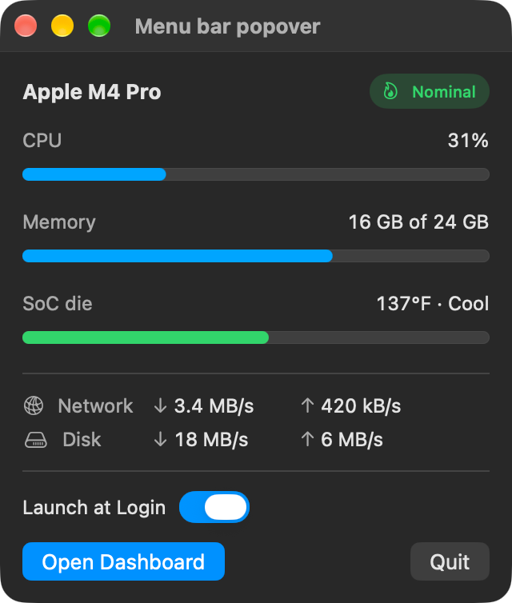
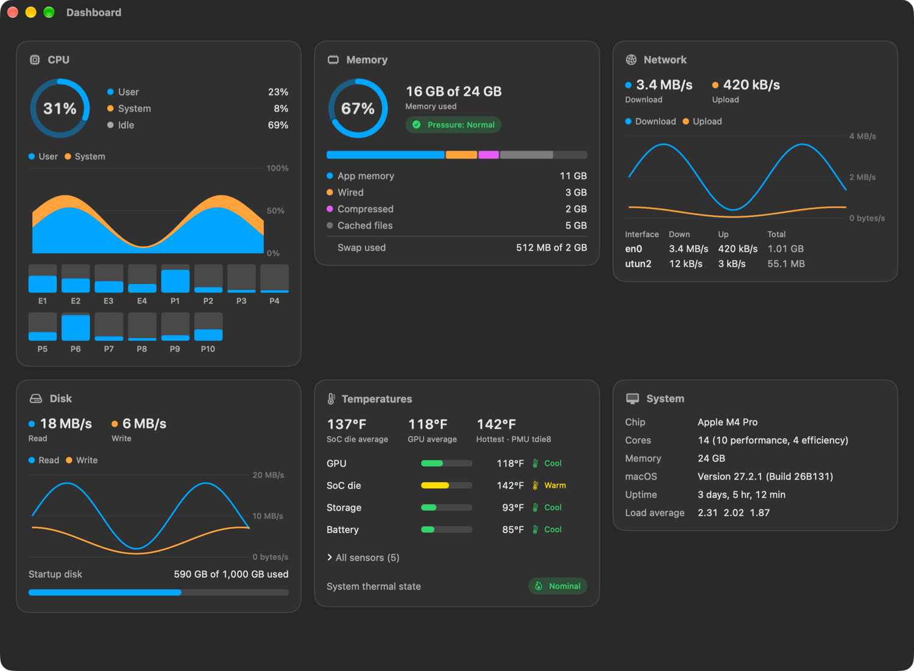

# Heartbeat

A macOS menu bar app that shows your Mac's vital signs at a glance: CPU load, memory, network and disk throughput, and temperatures.

  

*Screenshots are rendered from Xcode previews with sample data.*

## Features

- **Menu bar status item** showing live CPU load and SoC temperature.
- **Popover** with CPU, memory and temperature meters, network and disk rates, and the system thermal state.
- **Full dashboard** window with 60-second history charts and hover tooltips:
  - **CPU**: user/system/idle split and per-core load, labeled by efficiency and performance cores.
  - **Memory**: app, wired, compressed and cached memory using Activity Monitor's accounting, plus memory pressure and swap.
  - **Network**: download and upload rates with a per-interface breakdown.
  - **Disk**: read and write throughput and startup disk capacity.
  - **Temperatures**: per-category readings in Fahrenheit with Cool/Warm/Hot/Critical labels and a full sensor list.
  - **System**: chip, core layout, macOS version, uptime and load averages.
- **Adjustable refresh rate** from 0.5 to 5 seconds.
- **Launch at login**, enabled on first run and toggleable from the popover.

## Download

1. Download `Heartbeat-1.0.zip` from the [latest release](https://github.com/aaronarich/heartbeat/releases/latest).
2. Unzip it and move `Heartbeat.app` into your Applications folder.
3. Open it. The app isn't notarized, so macOS will block the first launch. Go to System Settings, then Privacy & Security, and click **Open Anyway** next to the Heartbeat message.

Heartbeat lives in the menu bar and has no Dock icon.

## Requirements

- macOS 27.2 or later
- Apple silicon for temperature readings
- Xcode 27 to build

## Building

1. Open `Heartbeat.xcodeproj` in Xcode.
2. Select your own development team under Signing & Capabilities.
3. Build and run. The app appears in the menu bar with no Dock icon.

For launch at login to survive cleaning DerivedData, copy the built app into `/Applications` and launch it from there once.

## How it works

| Area | Source |
|---|---|
| CPU | `host_processor_info` tick counters |
| Memory | `host_statistics64` and sysctl |
| Network | Routing socket 64-bit interface counters |
| Disk | IOKit `IOBlockStorageDriver` statistics |
| Temperatures | IOKit HID temperature sensor services |
| Login item | ServiceManagement `SMAppService` |

Sampling runs on a background actor that turns cumulative counters into rates. A single observable monitor feeds the status item, popover and dashboard.

## Caveats

- **App Sandbox is disabled.** Temperature sensors aren't reachable from inside the sandbox, so this app isn't suitable for the Mac App Store as is.
- **Temperature reading uses private IOKit HID functions.** Many Mac monitoring tools use the same calls, but they aren't public API and could change in a future macOS release.
- On M3 and M4 chips the sensors are reported as SoC die temperatures rather than separate CPU and GPU clusters.
